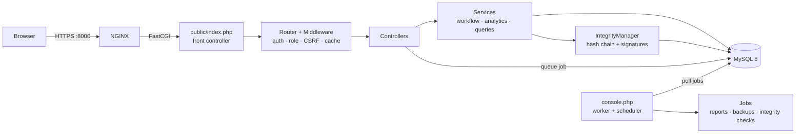
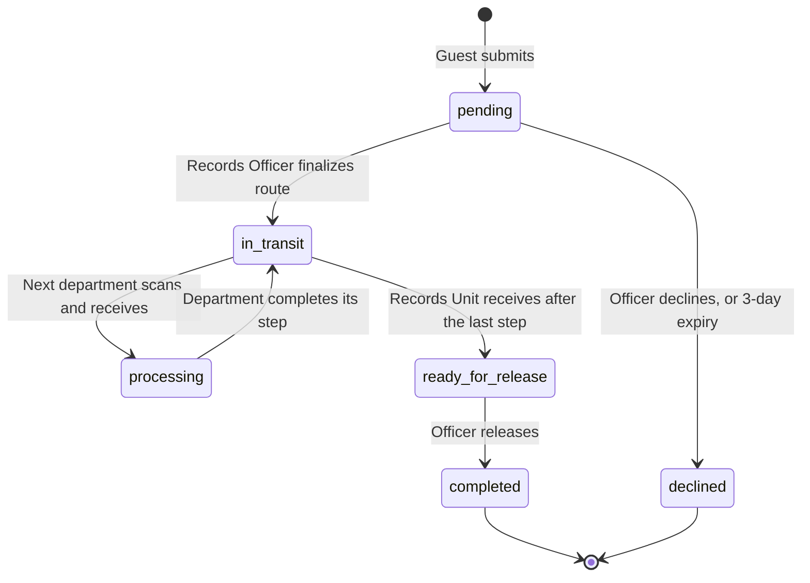

# DepEd Iligan Document Tracking System (DTS)


A web application for digitizing, routing, and tracking official documents for the **Department of Education (DepEd), Division of Iligan City**.

The system replaces paper-based routing slips with a role-based digital workflow. Every action on a document is written to a **tamper-evident audit trail**: each log entry is SHA-256 hash-chained to the previous one and signed with the acting user's **Ed25519** key. Citizens can submit and track documents without an account. Staff move documents between departments, and administrators can verify the integrity of every record at any time.

---

## Table of Contents

- [Overview](#overview)
- [Key Features](#key-features)
- [Technology Stack](#technology-stack)
- [System Architecture](#system-architecture)
- [Security Model](#security-model)
- [Screenshots](#screenshots)
- [Getting Started](#getting-started)
- [Configuration](#configuration)
- [Running with NGINX (Windows and Linux)](#running-with-nginx-windows-and-linux)
- [Command Reference](#command-reference)
- [Database Seeding](#database-seeding)
- [Legacy and Simulated Data](#legacy-and-simulated-data)
- [Project Structure](#project-structure)
- [Documentation](#documentation)
- [Default Test Accounts](#default-test-accounts)
- [License](#license)

---

## Overview

| | |
| :--- | :--- |
| **Purpose** | Digitize the intake, inter-department routing, and release of official documents |
| **Users** | Guests (citizens), Records Officers, Department Staff (14 units), Administrators |
| **Core guarantee** | Any change to a document or its history is detectable and attributable to a specific user |
| **Deployment** | Single server, plain PHP 8.3 + MySQL 8 behind NGINX; runs identically on Windows and Linux |
| **Current version** | `1.25.0-Release` (see [CHANGELOG.md](CHANGELOG.md)) |

### From Laravel to plain PHP

The system was first built on Laravel 12 and later rewritten in plain PHP with no framework. The Laravel codebase has been retired and remains only in git history. Its documentation is kept for reference in [documentation/laravel-era/](documentation/laravel-era/).

Reasons for the rewrite:

1. **No framework overhead.** Requests go straight from [public/index.php](public/index.php) to a small regex [Router](src/Core/Router.php) and raw PDO queries.
2. **Small dependency footprint.** Only three Composer packages: `dompdf` (tracking-form PDFs), `chillerlan/php-qrcode` (QR codes), and `openspout` (XLSX reports). The front end uses Tailwind CSS at build time only, plus vendored Chart.js, html5-qrcode, and SortableJS.
3. **Explicit concurrency control.** All document state changes go through [DocumentWorkflowService](src/Services/DocumentWorkflowService.php). Each change runs in a PDO transaction with optimistic locking (`WHERE version = :version`), so two users acting on the same document at the same time cannot both succeed.
4. **Built-in scheduler.** One CLI worker ([console.php](console.php)) processes queued jobs and runs periodic maintenance, so no cron setup is required.

---

## Key Features

### Document workflow
- **Guest submission and tracking.** Citizens submit documents without an account and receive a tracking code (`DEPED-` followed by 10 hex characters) and a printable PDF tracking form with a QR code. They can track several codes at once.
- **Purpose-based routing.** Each document purpose has a suggested department route that the Records Officer can reorder or adjust before finalizing. Purposes marked "Others" are routed manually by the officer.
- **Department workflow.** Documents move through `pending → in_transit → processing → … → ready_for_release → completed`, with `declined` and `frozen` as exceptional states. Departments receive and process documents in route order; the Records Office releases them. Every step is confirmed with the user's signing PIN.
- **QR code scanning.** Officers and staff receive documents by scanning the tracking form with a device camera.
- **Automatic expiry.** Submissions not taken in by the Records Office within 3 days are declined automatically, with a signed system log entry.

### Integrity and security
- **Cryptographic audit trail.** Every action is a hash-chained log entry signed with the user's Ed25519 key. See [Cryptographic Logs Explained](documentation/CRYPTOGRAPHIC_LOGS_EXPLAINED.md).
- **Integrity monitoring.** Administrators can run a background verification of every chain, **Rebuild Chain** for a corrupted entry, and **Freeze All** documents in an emergency. Tampered documents are frozen automatically.
- **Role-based access control.** Middleware and a document policy restrict every route and action by role and department.

### Operations and reporting
- **Dashboards.** Admin charts for load, throughput, decline trends, bottleneck hotspots, and peak hours, plus live database performance telemetry. Staff and officers get department-level statistics.
- **Reports.** Officers and staff queue XLSX reports of released documents. Finished reports stay under **Past Reports** for re-download.
- **Notifications.** In-app notification bell for report completion and workflow events, polled every 30 seconds.
- **Backups.** One-click `mysqldump` backups, compressed to ZIP, with download, restore, and delete.
- **Performance.** Cursor-based pagination, a 55-second per-user HTML response cache, and PJAX navigation. See [Caching & PJAX Explained](documentation/CACHING_AND_PJAX_EXPLAINED.md).

---

## Technology Stack

| Layer | Technology |
| :--- | :--- |
| Language / runtime | PHP 8.3+ (`pdo_mysql`, `sodium`, `mbstring`, `gd`, `zip`, `openssl`) |
| Database | MySQL 8 (InnoDB) |
| Web server | NGINX with PHP-FPM (Linux) or a `php-cgi` pool (Windows); PHP built-in server as a development fallback |
| Cryptography | libsodium: Ed25519 signatures, Argon2id key derivation; SHA-256 hash chaining |
| PDF / QR / Excel | dompdf, chillerlan/php-qrcode, OpenSpout |
| Front end | Server-rendered PHP views, Tailwind CSS 3, Chart.js, html5-qrcode, SortableJS, custom PJAX router |
| Tooling | Composer, Node.js (Tailwind build and seeders), optional Cloudflare Tunnel |

---

## System Architecture



**Request flow.** NGINX serves static assets directly and forwards everything else to the front controller. The router applies authentication, role, CSRF, and response-cache middleware before calling a controller. Controllers delegate business logic to services, and all document state changes pass through `DocumentWorkflowService` and `IntegrityManager`.

**Background processing.** Long-running work (XLSX reports, backups and restores, full integrity scans) is queued in the `jobs` table and picked up by the worker. The same process runs the scheduler:

| Interval | Task |
| :--- | :--- |
| 5 minutes | Database telemetry sampling |
| 30 minutes | Department metrics backfill (last 2 days) |
| Hourly | Response-cache garbage collection, log rotation |
| Daily | Metrics rollup, expiry of stale pending documents |

### Document lifecycle



A document cycles between `in_transit` and `processing` once per department on its route. Any active document can be **frozen**, either automatically when tampering is detected or by an administrator, and only an administrator can unfreeze it.

For full details, see [ARCHITECTURE.md](documentation/ARCHITECTURE.md).

---

## Security Model

| Concern | Mechanism |
| :--- | :--- |
| **Tamper evidence** | Each log entry stores a SHA-256 hash of the document's state together with the previous entry's hash. Changing any past record breaks every hash after it. |
| **Non-repudiation** | Each entry is signed with the acting user's Ed25519 private key and verified against that user's public key. |
| **Key protection** | Private keys are encrypted at rest with a key derived from the user's signing PIN (Argon2id via libsodium). The PIN is set at first login and is never stored. |
| **Authentication** | Passwords are hashed with PHP's `password_hash`. The session ID is regenerated at login, and session cookies are `HttpOnly` and `SameSite`. |
| **Request forgery** | Every state-changing request requires a CSRF token. |
| **Concurrency** | Optimistic locking with row versions inside PDO transactions. |
| **Incident response** | Automatic freeze on detected tampering, plus admin-initiated **Freeze All** and **Rebuild Chain**. |

A tampering demo is included: `composer run corrupt` modifies a document directly in the database so you can watch detection and the automatic freeze happen. See also the [Layman Guide to Hash Verification](documentation/HASH_VERIFICATION_LAYMAN_GUIDE.md) and [Quantum Safety](documentation/QUANTUM_SAFETY.md).

---

## Screenshots

| Guest Submission | Submission Success |
| :---: | :---: |
|  |  |
| **Document Intake (Officer)** | **Document Releasing (Officer)** |
|  |  |
| **Department Tasks (Staff)** | **Digital Signature Setup** |
|  |  |
| **Admin Dashboard** | **Admin Dashboard (Dark Mode)** |
|  |  |
| **System Overview** | **User Management** |
|  |  |

More screenshots are in [documentation/screenshots/](documentation/screenshots/).

**Sample output:** [Tracking form PDF](documentation/exports/document-tracking-form-DEPED-E5345FDA4F.pdf), with submitter information, document requirements, and a scannable QR code. Release reports (XLSX) are generated from **Statistics → Generate Report** and named `released-documents-<timestamp>-<count>docs[-filters].xlsx`. Generated `.xlsx` files are git-ignored, so no sample is committed.

---

## Getting Started

### Prerequisites

- **PHP 8.3+** with the `pdo_mysql`, `sodium`, `mbstring`, `gd`, `zip`, and `openssl` extensions. Windows also needs `php-cgi.exe`, which ships with PHP.
- **MySQL 8**, with the `mysql` and `mysqldump` clients on `PATH` (used for backups and restores).
- **Composer** and **Node.js** (for the Tailwind build and the Node seeders).
- **NGINX** (recommended). Without it, Windows falls back to PHP's built-in server. See [Running with NGINX](#running-with-nginx-windows-and-linux).

### Installation

1. **Clone the repository and install dependencies**
   ```bash
   git clone https://github.com/Jevoel16/DTS-Prototype.git
   cd DTS-Prototype
   composer install
   npm ci
   npm run build
   ```

2. **Configure the environment.** Copy `.env.example` to `.env` and set your database credentials (see [Configuration](#configuration)).

3. **Create and seed the database.** This creates `DB_DATABASE` if needed, loads [database.sql](database.sql), and seeds the 14 departments, document purposes, and default accounts.
   ```bash
   composer run seed:prod
   ```
   > **Warning:** `seed:prod` drops and recreates all tables. Do not run it against a database you want to keep.

4. **Start the server and background worker**
   ```bash
   composer run dev
   ```

5. **Open the application** at **https://localhost:8000** with NGINX (accept the self-signed certificate warning), or **http://localhost:8000** with the built-in server fallback. Sign in with one of the [default accounts](#default-test-accounts). Each user sets a signing PIN of at least 6 characters on first login.

### Upgrading an existing installation

Databases created before October 2026 need a one-time schema upgrade. It adds new indexes and drops unused Laravel tables, and it is safe to run more than once:

```bash
composer run migrate
```

---

## Configuration

All settings are read from `.env` in the project root. The `DB_*` and `APP_DEBUG` variables can also be set in the shell or by a process manager (systemd, CI), which overrides `.env`. This is useful for pointing a one-off command at a different database.

| Variable | Default | Description |
| :--- | :--- | :--- |
| `DB_HOST` | `localhost` | MySQL host |
| `DB_PORT` | `3306` | MySQL port |
| `DB_DATABASE` | `deped_dts` | Database name (created by `seed:prod` if missing) |
| `DB_USERNAME` | `root` | MySQL user |
| `DB_PASSWORD` | *(empty)* | MySQL password |
| `APP_DEBUG` | `false` | Show PHP errors in the browser. **Development only.** |
| `NGINX_PATH` | `C:\nginx` | *Windows only.* Path to `nginx.exe` or its folder (falls back to `PATH`) |
| `OPENSSL_PATH` | *(auto)* | *Windows only.* Path to `openssl.exe` or its folder (falls back to `PATH`, then Git for Windows' bundled copy) |
| `APP_URL` | `https://localhost:8000` | Base URL used by the `seed:dev` HTTP seeder. Use `http://localhost:8000` with the built-in server. |

For production sizing and InnoDB tuning, see [Hardware Specs & MySQL Tuning](documentation/HARDWARE_SPECS.md).

---

## Running with NGINX (Windows and Linux)

Both platforms use the same template, [nginx/site.conf](nginx/site.conf). `composer run dev` and `composer run prod` fill in the machine-specific values (project path, LAN IP, PHP connection, certificate and log paths), generate a self-signed certificate for `localhost` and your LAN IP, and serve **HTTPS on port 8000**. The configuration also enables gzip, 30-day browser caching for `/css`, `/js`, `/fonts`, and `/images`, and a 300-second FastCGI timeout for reports and PDFs.

| | Windows | Linux (Debian/Ubuntu) |
| :--- | :--- | :--- |
| **NGINX** | [nginx for Windows](https://nginx.org/en/download.html) zip extracted to `C:\nginx` (or set `NGINX_PATH`) | `sudo apt install nginx` |
| **PHP connection** | 4 `php-cgi.exe` processes on `127.0.0.1:9123–9126`, started by the script | PHP-FPM socket `/run/php/phpX.Y-fpm.sock` (`sudo apt install phpX.Y-fpm`) |
| **Generated config** | `storage/nginx/conf/nginx.conf` (project-local, no admin rights needed) | `/etc/nginx/sites-available/dts-prototype` (uses `sudo`) |
| **Certificate** | `storage/ssl/` (via `openssl`, e.g. the one bundled with Git for Windows) | `/etc/ssl/certs` and `/etc/ssl/private` (requires the `ssl-cert` group) |
| **Logs** | `storage/logs/dts_*.log`, `storage/nginx/logs/` | `/var/log/nginx/dts_*.log` |
| **Stopping** | Ctrl+C stops NGINX, php-cgi, and the worker | Ctrl+C stops NGINX and PHP-FPM |

Generated files live in git-ignored folders and are rebuilt on each start, so a project set up on one platform runs unchanged on the other.

**Fallback without NGINX (Windows, development only).** `composer run dev` runs `php -S 0.0.0.0:8000 -t public public/router.php` over plain HTTP, plus the worker. [public/router.php](public/router.php) sends every non-file URL to the front controller, as NGINX's `try_files` does, so URLs ending in a filename (such as backup downloads) still work. `composer run prod` always requires NGINX.

**Running the worker under a process manager.** In production, run `composer run prod -- --no-worker` and manage `php console.php` with systemd or Supervisor instead.

---

## Command Reference

### Server and worker

| Command | Description |
| :--- | :--- |
| `composer run dev` | Clears the response cache and starts NGINX (or the fallback server) and the queue worker. On Windows the worker restarts automatically after its 100-job / 256 MB limit. |
| `composer run prod` | Production server setup plus the worker (`-- --no-worker` to run the worker separately). |
| `composer run worker` | Runs only the [console.php](console.php) queue worker and scheduler. |
| `composer run proxy` | Exposes `https://localhost:8000` through a Cloudflare quick tunnel (requires `cloudflared`). |

### Build and database

| Command | Description |
| :--- | :--- |
| `npm run dev` | Tailwind watcher while editing views. |
| `composer run css` | One-off minified Tailwind build to `public/css/tailwind.css`. |
| `composer run migrate` | Upgrades an existing database to the current schema ([scripts/migrate.php](scripts/migrate.php)). |
| `php scripts/tune-database.php` | Sets the running MySQL's InnoDB buffer pool to 4 GB (`SET GLOBAL`, lost on restart; see [Hardware Specs](documentation/HARDWARE_SPECS.md) for the permanent setting). |
| `php scripts/daily-backup.php` | Creates a backup from the command line, e.g. for an OS scheduler. |
| `php scripts/backfill-metrics.php [--full]` | Rebuilds department metrics for the last 2 days, or all history with `--full`. The worker runs this automatically. |

### Security and testing

| Command | Description |
| :--- | :--- |
| `php scripts/generate-keys.php` | Generates missing Ed25519 keypairs for users. |
| `composer run corrupt` | Tampers with a document ([scripts/corrupt.php](scripts/corrupt.php)) to demonstrate tamper detection and the automatic freeze. |
| `php scripts/concurrency_test.php` | Simulates concurrent updates to one document to exercise optimistic locking. |

---

## Database Seeding

Seeders live in [scripts/seeders/](scripts/seeders/).

| Command | Description |
| :--- | :--- |
| `composer run seed:prod` | [setup-production-db.js](scripts/seeders/setup-production-db.js). **Drops and recreates all tables**, then seeds departments, purposes, and the default accounts. |
| `composer run seed:fast [docs]` | [fast-seed.php](scripts/seeders/fast-seed.php). Clears documents and logs, then inserts `docs` simulated documents (default 10,000) with valid signed hash chains directly in MySQL. |
| `composer run seed:dev [docs] [chunk] [concurrency]` | [seed.js](scripts/seeders/seed.js). Drives the running web server over HTTP to simulate many concurrent users; doubles as a load and concurrency test. Uses `APP_URL`. |
| `composer run seed:legacy [-- file.csv]` | [import-legacy.php](scripts/seeders/import-legacy.php). Imports real routing records from the previous DTS (see below). |

---

## Legacy and Simulated Data

`from_dts/` holds an export of the previous DTS's routing records (`dts_docroutes`).

- **Tracked in git:** `week_2026_07_20_to_07_23.csv` and `week_2026_07_27_to_07_30.csv`, weekly slices produced by [split_weekly_data.py](from_dts/split_weekly_data.py).
- **Not tracked (too large):** `dts_docroutes (1).csv` (~48 MB) and `dts_docroutes.sql` (~52 MB), the full export. Copy these manually when setting up a new clone.

Usage:

- **Import a week into the DTS.** This replaces existing documents and logs, then rebuilds metrics.
  ```bash
  composer run seed:legacy
  composer run seed:legacy -- from_dts/week_2026_07_20_to_07_23.csv
  ```
- **Regenerate the weekly CSVs** from the full export: `python from_dts/split_weekly_data.py`
- **Inspect the raw export:** load `from_dts/dts_docroutes.sql` into a separate scratch database. It creates its own `dts_docroutes` table and does not touch the DTS tables.

---

## Project Structure

```
DTS-Prototype/
├── public/                 Web root: index.php front controller, router.php, CSS, JS, fonts, images
├── src/
│   ├── Config/             Environment loading and app configuration
│   ├── Controllers/        HTTP controllers (guest, intake, tasks, releasing, admin, ...)
│   ├── Core/               Router, Database, IntegrityManager, Cache, Validator, security helpers
│   ├── Events/             Domain events (e.g. integrity check failures)
│   ├── Jobs/               Queued jobs: reports, backups, restores, integrity checks, expiry
│   ├── Middleware/         Authentication, role, and response-cache middleware
│   ├── Models/             Document and User models
│   ├── Policies/           Document access policy
│   ├── Services/           Workflow, query, analytics, and database-performance services
│   ├── Utils/              Offset and cursor paginators
│   └── Views/              Server-rendered PHP templates by role
├── scripts/                Dev/prod launchers, migrations, maintenance jobs, seeders
├── nginx/site.conf         NGINX template shared by Windows and Linux
├── documentation/          Manuals, technical docs, screenshots, sample exports
├── from_dts/               Legacy DTS data export and splitter script
├── console.php             Queue worker and scheduler
├── runner.php              Single-job runner
├── database.sql            Full database schema
├── composer.json           PHP dependencies and Composer scripts
└── package.json            Tailwind build and Node seeder dependencies
```

---

## Documentation

### User manuals
- **[Administrator Manual](documentation/user_manuals/admin_manual.md):** accounts, dashboards, integrity checks, Freeze All / Rebuild Chain, backups.
- **[Records Officer Manual](documentation/user_manuals/officer_manual.md):** intake, route finalization, tracking forms, QR scanning, releasing, reports.
- **[Department Staff Manual](documentation/user_manuals/staff_manual.md):** receiving, processing, remarks, and digital signatures.

### Technical documentation
- **[Architecture](documentation/ARCHITECTURE.md):** request flow, document lifecycle, hash chaining, routing, worker and scheduler.
- **[Cryptographic Logs Explained](documentation/CRYPTOGRAPHIC_LOGS_EXPLAINED.md)** and the **[Layman Guide to Hash Verification](documentation/HASH_VERIFICATION_LAYMAN_GUIDE.md)**.
- **[Quantum Safety](documentation/QUANTUM_SAFETY.md):** how the hash chain and signatures hold up against quantum attacks.
- **[Caching & PJAX Explained](documentation/CACHING_AND_PJAX_EXPLAINED.md)**
- **[Hardware Specs & MySQL Tuning](documentation/HARDWARE_SPECS.md):** server sizing and InnoDB buffer pool tuning.
- **[Value Proposition & Pitch](documentation/PITCH_AND_VALUE_PROPOSITION.md)**
- **[Laravel-era documentation](documentation/laravel-era/):** historical only; describes the retired Laravel version.

---

## Default Test Accounts

All seeded accounts use the password **`password`**.

> **Important:** These credentials are for development and evaluation only. Change every password before deploying to a shared or production environment.

| Role | Username |
| :--- | :--- |
| Administrator | `admin` |
| Records Officer | `records.unit` |
| Staff: Cash Unit | `cash.unit` |
| Staff: Administrative Unit | `administrative.unit` |
| Staff: Personnel | `personnel.unit` |
| Staff: Supply Unit | `supply.unit` |
| Staff: Budget Unit | `budget.unit` |
| Staff: Accounting | `accounting.unit` |
| Staff: Legal Unit | `legal.unit` |
| Staff: Health & Nutrition | `health.and.nutrition` |
| Staff: Bids and Awards Committee | `bids.and.awards.committee.unit` |
| Staff: Schools Division Superintendent Office | `schools.division.superintendent.office` |
| Staff: Assistant SDS Office | `assistant.schools.division.superintendent.office` |
| Staff: Curriculum Implementation Division | `curriculum.implementation.division` |
| Staff: School Governance and Operations Division | `school.governance.and.operations.division` |

---

## License

**Non-Commercial Government-Backed Project License.** Copyright © 2026 DepEd Division of Iligan City.

This project is a government-backed initiative for the DepEd Division of Iligan City. You may clone, use, and modify the system for internal use. You may **not** sell, rent, profit from, or redistribute the system or its derivatives. See [LICENSE](LICENSE) for the full terms.

---

<p align="center">Developed for the <strong>DepEd Division of Iligan City</strong>.</p>
